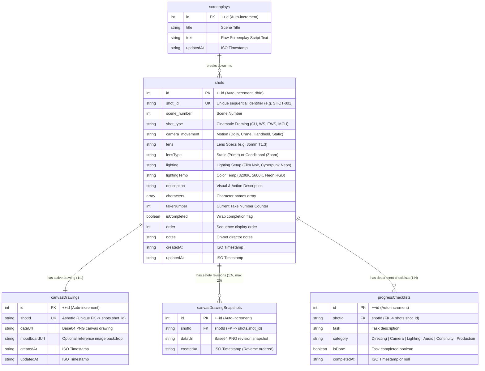

# FilmDot Architecture & UML Diagrams Guide

This directory contains production-ready **Draw.io (`.drawio`) XML diagram files** and architectural references for **FilmDot**, the AI-powered filmmaking, storyboarding, and on-set production toolkit.

---

## 📂 Included Draw.io Files

| File | Description | Diagrams / Views |
| :--- | :--- | :--- |
| **`filmdot_master.drawio`** | **All-in-One Multi-Page Draw.io File** | 6 Tabbed Pages: Use Case, ERD, 3 Sequence Diagrams, Tool Flow |
| **`filmdot_use_case.drawio`** | **System Use Case Diagram** | Actors (Director, DP, Crew, Gemini AI, Dexie DB) & 16 Use Cases |
| **`filmdot_database_erd.drawio`**| **Database Relationships (ERD)** | Dexie IndexedDB 5 object stores, keys, indexes & cardinality |
| **`filmdot_sequence_diagrams.drawio`** | **Core Sequence Diagrams** | AI Script Breakdown, Storyboard Drawing, On-Set Tracking |
| **`filmdot_tool_flow.drawio`** | **Tool Flow & Layered Architecture** | 4-Tier end-to-end architecture & data pipeline |

---

## 🚀 How to Open and Edit the `.drawio` Diagrams

You have three easy ways to view and edit these diagrams:

### Option 1: Web Browser (Free, Instant)
1. Navigate to **[app.diagrams.net](https://app.diagrams.net/)** (formerly draw.io).
2. Click **Open Existing Diagram**.
3. Select any `.drawio` file from `diagrams/` (e.g. `filmdot_master.drawio`).
4. In `filmdot_master.drawio`, use the page tabs at the bottom to navigate between diagrams!

### Option 2: Visual Studio Code / Cursor Extension
1. Install the official **"Draw.io Integration"** extension (by *Henning Dieterichs*).
2. Click on any `.drawio` file directly in the file explorer to view and edit visually right inside your editor.

### Option 3: Draw.io Desktop App
1. Download from [drawio.com](https://www.drawio.com/).
2. Open any file directly from disk.

---

## 🗄️ 1. Database Entity-Relationship (ERD) Reference

FilmDot uses **Dexie.js** over client-side **IndexedDB** (`FilmDotDatabase` v1) for 100% offline-first resilience on set.

---

## ⚡ 2. Tool Flow & Sequence Summaries

### Flow A: AI Screenplay Breakdown (`geminiService.js`)
1. User enters screenplay draft or keeps default Neon Noir sample.
2. User clicks **Break Down Script**.
3. `geminiService.js` sends prompt with strict JSON schema to **Google Gemini 3.8 Flash** (`@google/genai`).
4. In parallel, `screenplayDB.saveScreenplay()` persists draft to IndexedDB.
5. Parsed shot list is sanitized and saved into `shotsDB.saveShots()`.
6. `generateFlowFromShots()` constructs 2-column layout nodes and sequential animated edges in `@xyflow/react`.
7. *Offline Failover:* If offline or API key is missing, `DEMO_FALLBACK_SHOTS` are automatically seeded into IndexedDB.

### Flow B: Storyboard Canvas Drawing & Revision Safety (`StoryboardCanvas.jsx`)
1. Artist draws with stylus or mouse on Fabric.js canvas.
2. `path:created` triggers canvas export to Base64 PNG.
3. `canvasDrawingsDB.saveDrawing()` updates active record in `canvasDrawings`.
4. Concurrently, a revision snapshot is stored in `canvasDrawingSnapshots`, pruning beyond 20 history items.
5. Thumbnail is pushed back to `ShotNode` without disrupting drawing flow.
6. `Ctrl+Z` / `Ctrl+C` immediately executes local undo stack.

### Flow C: On-Set Take Recording & Wrap Checklist (`ShotNode.jsx`)
1. 1st AD / Camera Crew taps `+` to advance `takeNumber`.
2. Wrap checkbox toggles `isCompleted: true`.
3. Changes persist immediately to IndexedDB via `shotsDB.updateShot(dbId, ...)`.
4. Production department checklist items (Directing, Camera, Lighting, Audio, Continuity, Production) are checked off via `checklistDB.toggleItem()`.
5. Top bar header recalculates wrapped percentage progress live.
